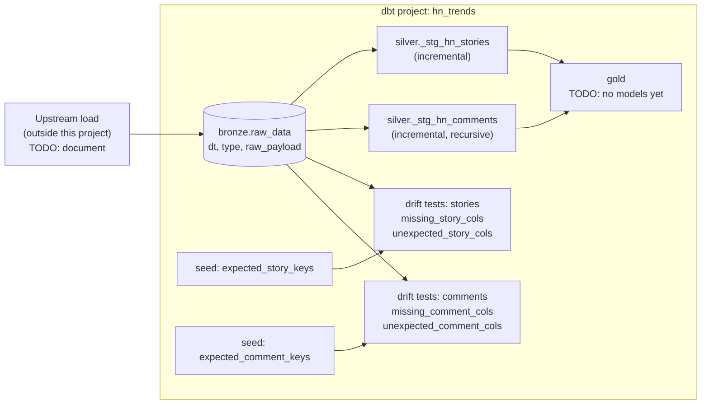

# hn_trends

A dbt project that turns raw Hacker News (HN) story and comment payloads into cleaned, typed **silver** tables, with **schema drift checks** that flag when the shape of the incoming JSON changes.

> Scope: this README only describes what exists inside the `hn_trends/` dbt project. Anything not built yet is marked **TODO**.

## Overview

- **Engine:** DuckDB. The dbt profile is named `duckdb_conn` (see [dbt_project.yml](dbt_project.yml)), and the SQL uses DuckDB JSON functions (`json_extract`, `json_keys`, `unnest`, `list_contains`).
- **Input:** one source table, `bronze.raw_data`, with columns used by the models: `dt`, `type` (`'story'` or `'comment'`) and `raw_payload` (JSON).
- **Output:** two incremental silver tables, `_stg_hn_stories` and `_stg_hn_comments`.
- **Quality:** column-level dbt tests on the silver models, plus four singular tests and two seeds that compare the keys in the raw JSON against an expected list.
- **Packages:** `dbt-labs/dbt_utils >= 1.3.0` is declared in [packages.yml](packages.yml). No model or test in the project currently calls it.

Not covered here:

- How `bronze.raw_data` is populated. It lives outside this project. **TODO:** document the upstream load.
- The gold layer. **TODO:** see [Gold layer](#gold-layer).
- The connection details in `profiles.yml`. **TODO:** document the profile setup without credentials.

## Architecture



Data tests on the silver models are declared in [models/silver/_silver_properties.yml](models/silver/_silver_properties.yml). The drift tests read the **bronze** table directly, not the silver tables.

## Folder structure

```
hn_trends/
├── dbt_project.yml          # project config: paths, materializations, seed config
├── packages.yml             # dbt_utils dependency
├── package-lock.yml         # locked package versions
├── profiles.yml             # connection profile (not documented here, see TODO above)
├── models/
│   └── silver/
│       ├── _src_hn_trends.yml        # source: hn_trends_brnz -> bronze.raw_data
│       ├── _silver_properties.yml    # column docs and data tests for silver models
│       ├── _stg_hn_stories.sql       # silver stories model
│       └── _stg_hn_comments.sql      # silver comments model
├── seeds/
│   ├── expected_story_keys.csv       # expected JSON keys for stories
│   └── expected_comment_keys.csv     # expected JSON keys for comments
├── tests/                            # singular tests (schema drift)
│   ├── missing_story_cols.sql
│   ├── unexpected_story_cols.sql
│   ├── missing_comment_cols.sql
│   └── unexpected_comment_cols.sql
└── .vscode/extensions.json
```

`dbt_project.yml` also declares `macros/` as a macro path, but no `macros/` folder exists. It also declares a `gold` model config, but there is no `models/gold/` folder.

## Data layers

### Bronze (source only)

Declared in [models/silver/_src_hn_trends.yml](models/silver/_src_hn_trends.yml) as source `hn_trends_brnz`, schema `bronze`, table `raw_data`. The project does not build or test this table. No source freshness or source tests are defined. **TODO:** add them if wanted.

### Silver

Configured in `dbt_project.yml` as `materialized: table` in schema `silver`. Both models override this with `incremental` and the `delete+insert` strategy.

#### `_stg_hn_stories` ([SQL](models/silver/_stg_hn_stories.sql))

| | |
|---|---|
| Source rows | `raw_data` where `type = 'story'`; each row's JSON holds a `hits` array that is unnested |
| Incremental key | `story_dt` (replaces a whole day at a time) |
| Incremental filter | `dt between var('start_date') and var('end_date')`. The filter applies on incremental runs only. |
| Dedup | `qualify row_number() over (partition by story_id order by dt, story_created_at_ts) = 1` keeps one row per `story_id` |
| Columns | `story_dt`, `story_id`, `author`, `title`, `url`, `points`, `num_comments`, `story_created_at_ts`, `updated_at`, `tags`, `front_page`, `ask_hn`, `show_hn`, `children`, `date_loaded` |

`front_page`, `ask_hn` and `show_hn` are flags derived from the `_tags` list.

#### `_stg_hn_comments` ([SQL](models/silver/_stg_hn_comments.sql))

| | |
|---|---|
| Source rows | `raw_data` where `type = 'comment'`; `raw_payload` is treated as a JSON array of top-level items |
| Flattening | A recursive CTE (`comment_nodes`) walks each item's `children` and records the nesting level as `depth` |
| Incremental key | `comment_dt` (replaces a whole day at a time) |
| Incremental filter | Same `start_date` / `end_date` filter as stories, on incremental runs only |
| Dedup | None in the model. `comment_id` uniqueness is checked by a test. |
| Columns | `comment_dt`, `story_id`, `comment_author`, `comment_id`, `comment_created_at_ts`, `comment_text`, `comment_url`, `comment_parent_id`, `comment_story_id`, `depth`, `date_loaded` |

#### Silver tests ([_silver_properties.yml](models/silver/_silver_properties.yml))

`_stg_hn_stories`:

| Column | Tests |
|---|---|
| `story_dt` | `not_null` |
| `story_id` | `not_null`, `unique` |
| `author` | `not_null` |
| `title` | `not_null` |
| `story_created_at_ts` | `not_null` |
| `points` | `not_null` with `warn_if: ">0"` and `error_if: ">100"` (a few nulls warn, many fail) |

`_stg_hn_comments`:

| Column | Tests |
|---|---|
| `comment_dt` | `not_null` |
| `comment_id` | `not_null`, `unique` |
| `comment_author` | `not_null` |
| `comment_created_at_ts` | `not_null` |
| `comment_text` | `not_null` |
| `comment_story_id` | `not_null` |

No `relationships` tests (for example comment to story) and no `accepted_values` tests exist. **TODO:** add them if wanted.

### Gold layer

`dbt_project.yml` configures `gold` models as tables in schema `gold`, but there are **no gold models yet**. **TODO:** build the gold models (for example trend aggregates).

## Schema drift checks

The idea is to compare the JSON keys that actually appear in `bronze.raw_data` with a list of expected keys kept in seed files. All four tests are singular tests in `tests/`, and a singular test fails when it returns rows. They filter on `dt between var('start_date') and var('end_date')`.

### Expected-key seeds

| Seed | Columns | Notes |
|---|---|---|
| [expected_story_keys.csv](seeds/expected_story_keys.csv) | `key_name`, `is_required` | 10 keys; `url` and `children` are optional |
| [expected_comment_keys.csv](seeds/expected_comment_keys.csv) | `key_name`, `is_required` | 13 keys; the file also has trailing empty columns |

Seeds load into the `silver` schema and are tagged `schema_drift` through `dbt_project.yml`. Test queries compare against `lower(key_name)`, so the case used in the seed CSV does not matter.

### Tests

| Test | Looks at | Fires when | Severity |
|---|---|---|---|
| `missing_story_cols` | story `hits[*]` keys | a **required** key from `expected_story_keys` is absent from the payload | error (default). Tag: `schema_drift` |
| `unexpected_story_cols` | story `hits[*]` keys | a key in the payload is **not** in `expected_story_keys` | `warn`. Tag: `schema_drift` |
| `missing_comment_cols` | top-level comment item keys | a **required** key from `expected_comment_keys` is absent | error (default). Tag: `schema_drift` |
| `unexpected_comment_cols` | top-level comment item keys | a key in the payload is **not** in `expected_comment_keys` | `warn`. Tag: `schema drift` (with a space; see below) |

So a missing required field fails the run, and a new unrecognised field only warns.

Both comment checks inspect only the keys of the top-level items. They do not inspect nested `children`.

### Running them

```bash
# seeds first, so the expected-key tables exist
dbt seed
dbt test --select tag:schema_drift --vars '{start_date: "YYYY-MM-DD", end_date: "YYYY-MM-DD"}'
```

The `start_date` and `end_date` variables are not defined in `dbt_project.yml`, so they must be passed on the command line (or defined elsewhere). **TODO:** document the orchestration that supplies them.

## Design decisions

These are read from the code. The reasons are inferred, except where the code has a comment.

- **Raw JSON stays in bronze, parsing happens in silver.** The models extract and cast fields from `raw_payload` with DuckDB JSON functions.
- **Incremental, day-grain `delete+insert`.** Each model uses `story_dt` or `comment_dt` as its `unique_key`, so rerunning a date range replaces those days and does not duplicate them. The date window comes from `start_date` and `end_date`.
- **Story dedup in SQL.** The `qualify` clause keeps one row per `story_id`. Commit history says this was added to handle duplicate `story_id`s.
- **Recursive CTE for comment threads.** Nested `children` are flattened into rows, with `depth` recording the nesting level. Commit history says SQL was rewritten to fix memory issues in the container.
- **Drift detection through seeds, not hard-coded SQL.** The expected key lists are data, so adding or relaxing a key is a CSV edit.
- **Required vs optional keys.** `is_required` separates keys whose absence is an error from keys whose absence is tolerated.
- **Two-sided drift check.** Missing required keys fail, and unexpected keys only warn, so new upstream fields don't block a run.
- **Graduated null check on `points`.** A few nulls warn, and more than 100 error.
- **`static_analysis: baseline`** is set for models, with a comment in the config saying it is a relaxed alternative to `strict`.
- **dbt version is pinned for the container**, per commit history. The pin itself is not in this folder. **TODO:** document where it is set.

## Known issues and TODOs

Things in the code that look unintended. They are listed as found and have not been fixed.

- **Seed config key mismatch.** In `dbt_project.yml`, the `column_types` block for the comment seed is keyed `unexpected_comment_keys`, but the seed file is `expected_comment_keys.csv`. The `column_types` override most likely does not apply to that seed.
- **Hard-coded schema in a test.** `tests/missing_story_cols.sql` reads `hn_proj_silver.expected_story_keys` and does not use `ref('expected_story_keys')`. It depends on that schema name existing, unlike the other three tests.
- **Tag typo.** `tests/unexpected_comment_cols.sql` uses the tag `"schema drift"` (space), so `--select tag:schema_drift` will not pick it up.
- **Unused or missing pieces.** `dbt_utils` is declared but unused. The `macros/` and `models/gold/` folders do not exist.
- **No dedup in the comments model.** Only a `unique` test guards `comment_id`.
- **Missing-key tests are not per day.** The `missing_*` tests left join the expected keys to the keys seen across the whole date window. The date column therefore comes back null for a missing key, and a key present on any one day counts as present.
- **TODO:** gold models, source freshness, relationship tests, orchestration docs, profile setup docs, upstream bronze load docs.
